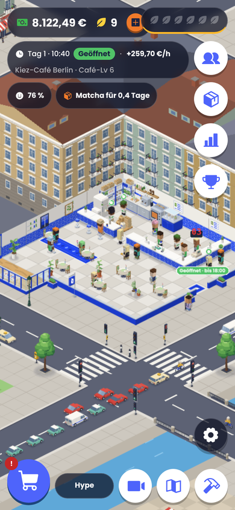
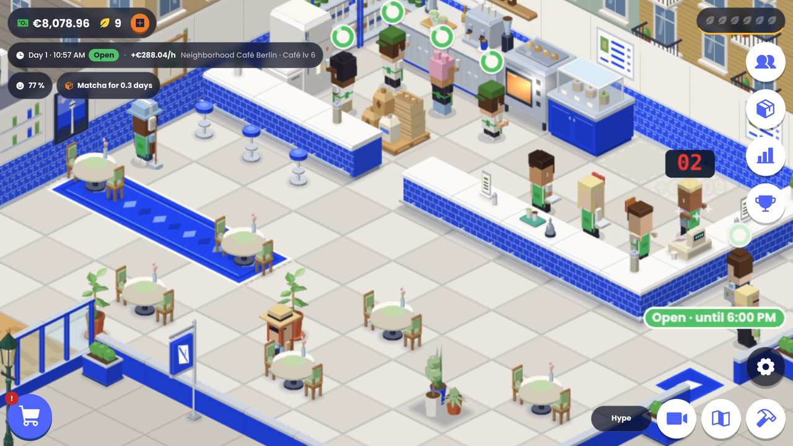

# Matcha Café Empire

Idle-/Tycoon-Browserspiel: Baue ein kleines Matcha-Café in Berlin zur Kette bis nach Bali aus. Gäste bestellen an der Theke, Baristas bereiten zu, Bedienungen servieren, Putzkräfte halten alles sauber; das Café hat Öffnungszeiten, Tag und Nacht, Wetter, Stammgäste und echte Preise in Euro. Du kaufst Ausstattung, stellst Personal ein und entlässt es wieder, bestellst Matcha beim Lieferanten, postest Videos für mehr Follower, baust den Parkplatz aus, behebst den Engpass, behältst Zufriedenheit und Tagesbilanz im Blick, eröffnest Standorte und sammelst per Franchise-Reset Zen. Läuft im Browser und als installierbare PWA, auf Deutsch und Englisch, ohne Werbung und ohne Käufe; der Spielstand bleibt lokal im Browser.

Version 1.0.0 – Änderungen in [CHANGELOG.md](CHANGELOG.md).

| Handy                                                                                           | Desktop                                                                                          |
| ----------------------------------------------------------------------------------------------- | ------------------------------------------------------------------------------------------------ |
|  |  |

Weitere Screenshots: Leben in der Szene (Regen, Wolken, Gespräche, Stammgast, Lieferant mit Sackkarre, Kamera-Schwenk zum Parkplatz): [`docs/screenshots/leben-in-der-szene/`](docs/screenshots/leben-in-der-szene/); Phase 3 (Tag und Nacht, Einkauf, Personal, Social Media, Tagesbilanz, Parkplatz): [`docs/screenshots/realistisches-cafe/`](docs/screenshots/realistisches-cafe/); Version 1.0: [`docs/screenshots/v1/`](docs/screenshots/v1/); Phase 2 (bedientes Café, Pipeline-Karte): [`docs/screenshots/s10/`](docs/screenshots/s10/); Ausstattung in fünf Optik-Stufen (Katalog, Café am Start / in der Mitte / im Luxus-Ausbau): [`docs/screenshots/ausstattung/`](docs/screenshots/ausstattung/).

## Technik

Vite + TypeScript + Phaser 3 (Szene), DOM-Overlay für die UI, i18n DE/EN, Spielstand in `localStorage` mit Sicherungen in IndexedDB. Die Spiellogik in `src/core` ist pur und ohne Phaser/DOM getestet; dort läuft auch die Spieluhr (geöffnet 1 Spielstunde = 1 Minute, nachts Zeitraffer). Einnahmen kommen nur aus dem Rate-Modell pro Spielstunde, die Figuren in der Szene sind Kosmetik.

## Start

```
pnpm install
pnpm dev          # http://localhost:5173/Tycoon-/  (?lang=de|en, ?tutorial=0 ohne Tutorial)
pnpm check        # lint + typecheck + test
pnpm e2e          # Playwright (einmalig: pnpm exec playwright install chromium)
pnpm build        # Produktions-Build nach dist/ (base: /Tycoon-/)
pnpm preview      # Build lokal ansehen
pnpm sim --hours 10 # Headless-Balancing-Simulation mit Greedy-Spieler (--log; Experimente: --set demand.basePerHour=12, --stationGrowth 0.8, --stationCost 0.8, --branchCost 0.5)
pnpm art            # Sprites neu rendern (braucht Chromium: PW_CHROMIUM=…)
```

Deploy: Der Build in `dist/` ist statisch und läuft unter jedem Pfad `/Tycoon-/`, z. B. GitHub Pages (Workflow `pages.yml`).

## Doku

- `CLAUDE.md` – Projektregeln
- `docs/PLAN.md` – Architektur und Session-Plan (S0–S9, Phase 2: S10–S12, Phase 3: realistisches Café)
- `docs/GAME_DESIGN.md` – Spieldesign und Formeln
- `docs/UI_STYLE.md` – UI- und Grafikstil
- `docs/STATUS.md` – Stand, offene Punkte, Entscheidungen, Balancing-Snapshot
- `docs/ROUTINE.md` – autonomer Session-Loop
- `docs/ASSETS.md` – Herkunft/Lizenz aller Assets
